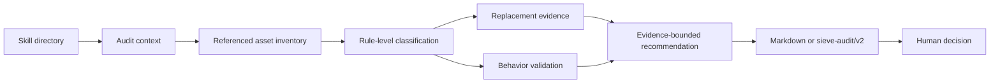

<div align="center">

# 🧹 Sieve Skill

**[English](README.md) · [简体中文](README.zh-CN.md)**


### Evidence-based auditing for Agent Skills

Find what to **keep**, **compress**, **externalize**, or **compare**—without turning an audit into a destructive action.

</div>

---

Sieve treats a Skill as a collection of independently valuable assets rather than assigning one label to the whole directory. It separates reusable business knowledge from generic instructions, temporary scaffolding, tests, generated files, and secrets.

> **Read-only by default.** Every recommendation is bounded by the evidence actually collected. Sieve does not modify, move, archive, or delete the Skill being audited.

## 🔍 Why Sieve?

As models improve, some instructions become redundant. Others only look redundant because the real value is hidden in failure cases, acceptance criteria, privacy constraints, or workflow contracts.

Two shortcuts are equally unsafe:

- “The model is better now, so the Skill is obsolete.”
- “This Skill contains experience, so every line must stay.”

Sieve replaces both shortcuts with a rule-level audit:

1. Record the model, version, task sample, and comparison scope.
2. Inventory only the entrypoint and resources it actually references.
3. Classify decision-making assets independently from repository file roles.
4. Keep model-replacement evidence separate from behavior validation.
5. Cap every recommendation at the strongest evidence available.

## ✨ What It Does

- Builds a secret-aware inventory and reference graph.
- Classifies rule blocks as `generic`, `temporary`, `proprietary`, `mixed`, or `unknown`.
- Tracks lifecycle separately: `active`, `possibly_redundant`, `model_dependent`, `task_dependent`, `needs_test`, or `historical`.
- Distinguishes model replacement evidence from implementation or behavior tests.
- Produces conservative recommendations: `keep`, `compress`, `externalize`, `temporary`, `needs_comparison`, `human_review`, or `archive_candidate`.
- Emits a concise Markdown audit or a validated `sieve-audit/v2` JSON report.
- Verifies report counts, evidence paths, source lines, confidence limits, and archival prerequisites.

## 🛡️ What It Never Does

- It never recommends `delete`.
- It never treats an audit recommendation as permission to change files.
- It never reads, summarizes, or hashes secret contents.
- It never treats passing tests as proof that a model can replace a rule.
- It never treats a model comparison as proof that an implementation is correct.
- It never recommends `archive_candidate` without E3 evidence, an external-caller check, and required human review.
- It never generalizes a result beyond the models, versions, and tasks recorded in the audit.

## 🚀 Quick Start

### 🔧 1. Install the Skill

Clone this repository, then place or link the directory in the Skill location supported by your agent runtime:

```bash
git clone <repository-url> sieve-skill
```

Consult your runtime documentation for its Skill discovery directory. The workflow itself is runtime-neutral and does not require a runtime-specific command.

### 💬 2. Ask Your Agent to Audit a Skill

```text
Use sieve-skill to audit /path/to/example-skill.
Only analyze it; do not modify any files.
Tell me what should be kept, compressed, externalized, or compared,
and cite the evidence for each recommendation.
```

For a machine-readable report:

```text
Audit /path/to/example-skill with sieve-skill and output sieve-audit/v2 JSON.
Validate the report against the audited Skill directory.
```

### 🧪 3. Run the Deterministic Helpers

Create a secret-aware inventory:

```bash
python3 scripts/inventory_skill.py /path/to/example-skill
```

Write it to a file:

```bash
python3 scripts/inventory_skill.py /path/to/example-skill \
  --output /tmp/example-inventory.json
```

Validate a report and verify its evidence paths and source lines:

```bash
python3 scripts/validate_report.py /path/to/audit.json \
  --skill-directory /path/to/example-skill
```

Schema-only validation remains available by omitting `--skill-directory`, but it is not sufficient for a formal audit.

## ⚙️ How It Works



### 🧭 Two Evidence Tracks

| Track | Question | Valid evidence |
|---|---|---|
| Replacement evidence | Can the current model replace this rule? | Skill structure, controlled with/without-Skill comparisons, multi-model real-task comparisons |
| Behavior validation | Does the current rule or implementation behave as claimed? | Automated tests, fixed acceptance criteria, historical human-approved results, real failure cases |

These tracks are deliberately independent. A passing unit test does not prove that a rule is obsolete, and a good model output does not prove that a script is correct.

## 📊 Evidence Levels

| Level | Evidence | Most aggressive permitted recommendation |
|---|---|---|
| E0 | Intuition only | `human_review` |
| E1 | Read-only structural evidence | `compress`, `externalize`, or `needs_comparison` |
| E2 | Controlled comparison on one model and a bounded task set | Model- and task-scoped `temporary` or `compress` |
| E3 | Multiple models and real tasks using the same independent acceptance criteria | `archive_candidate`, still requiring human review |

If the model cannot be identified, confidence is capped at `low`. If external callers have not been checked, archival cannot be recommended.

## 🧩 Asset Model

Sieve evaluates two orthogonal properties.

### 📁 Repository role (`artifact_role`)

`instruction`, `reference`, `source`, `test`, `asset`, `metadata`, `generated`, `binary`, `secret`, or `historical`.

### 💎 Rule value (`asset_type`)

`generic`, `temporary`, `proprietary`, `mixed`, `unknown`, or `not_applicable`.

A test file may contain proprietary acceptance knowledge. A long instruction may still be generic. Secrets, binaries, and generated outputs are repository artifacts, not rule-value candidates, and use `asset_type=not_applicable`.

## 📝 Example Audit Result

```markdown
# Skill Audit Report

## Overall judgment

Keep the workflow contract and safety constraints. Compress repeated generic
instructions. Run a controlled comparison before changing the generation steps.

## Audit context

- Model: unknown
- Model version: unknown
- Comparison performed: no
- Replacement evidence: E1
- Confidence: low

## Evidence

| Rule block | Source | Evidence | Recommendation |
|---|---|---|---|
| Safety and privacy constraints | SKILL.md:14 | E1 | keep |
| Generic inventory procedure | SKILL.md:45 | E1 | needs_comparison |

## Not performed

No files were modified, moved, archived, or deleted.
```

The complete JSON contract is documented in [`references/report-schema.md`](references/report-schema.md). Classification rules are documented in [`references/rubric.md`](references/rubric.md).

## 🔐 Safety Model

Sieve is designed for repositories that may contain sensitive or operationally important material:

- `.env` files, private keys, certificates, and credentials are reported only by path, byte size, and sensitive type.
- Secret contents are never read, summarized, quoted, or hashed.
- External URLs are normalized and recorded but are not followed automatically.
- Repository-local references do not prove that no external caller exists.
- Every recommendation requires human approval; an audit never grants execution authority.
- Invalid targets, unreadable references, empty test collection, and failed report validation produce explicit stop or fallback behavior.

## 📁 Repository Layout

```text
sieve-skill/
├── SKILL.md
├── README.md
├── README.zh-CN.md
├── references/
│   ├── rubric.md
│   └── report-schema.md
├── scripts/
│   ├── inventory_skill.py
│   └── validate_report.py
└── tests/
    ├── fixtures/
    └── test_scripts.py
```

## ✅ Testing

The repository uses Python's standard-library test runner and has no required third-party Python dependency for its current deterministic helpers.

```bash
python3 -m unittest discover -s tests -v
```

The tests cover inventory behavior, secret handling, binary detection, external-reference normalization, report consistency, evidence requirements, confidence limits, source-path checks, and archival safeguards.

## ⚠️ Limitations

- Without a controlled comparison, replacement evidence cannot exceed E1.
- Model-based auditing can still make classification errors.
- External callers cannot be ruled out by repository-local scanning alone.
- Rule-block percentages describe the identified audit units; they are not scientific measurements.
- `archive_candidate` means “consider archiving after human review,” not “safe to delete.”
- Results apply only to the recorded model, version, tasks, and audit date.

## 🗺️ Roadmap

- A reproducible with/without-Skill comparison harness.
- Multi-model comparison reports using shared acceptance criteria.
- Continuous-integration examples for report validation.
- Additional real-world, privacy-safe audit fixtures.

## 🤝 Contributing

Contributions should preserve the separation between replacement evidence and behavior validation.

When submitting a change:

1. Explain the failure mode or audit gap being addressed.
2. Add or update a deterministic test when behavior changes.
3. Run the full test suite.
4. Avoid committing real credentials, private business samples, or personally identifying paths.
5. Treat schema changes as compatibility changes and document them explicitly.

Security-sensitive findings should not include secret contents in public issues.

## 📜 License

No license file is included yet. Add an explicit open-source license before public release; without one, reuse and redistribution rights are not granted by default.
