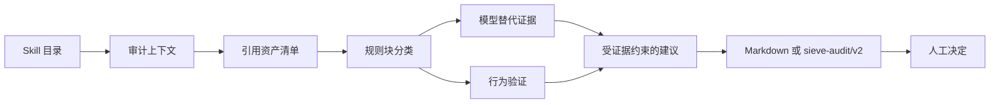

<div align="center">

# 🧹 Sieve Skill

**[English](README.md) · [简体中文](README.zh-CN.md)**


### 用证据审计 Agent Skill

判断哪些内容应该**保留**、**压缩**、**外移**或**对照验证**，同时避免把一次审计变成破坏性操作。

</div>

---

Sieve 不会粗暴地给整个 Skill 贴上“有用”或“过时”的标签，而是把它拆成可以独立判断的规则资产。它会区分业务知识、通用指令、临时脚手架、测试、生成物和秘密文件。

> **默认只读。** 所有建议都受本次实际证据约束；Sieve 不会修改、移动、归档或删除被审计的 Skill。

## 🔍 为什么需要 Sieve？

模型越来越强，一部分旧指令确实可能变得多余；但另一些内容看起来普通，真正保存的却是失败案例、验收标准、隐私边界或上下游契约。

两种简单判断都很危险：

- “模型已经变强了，所以这个 Skill 没用了。”
- “这里都是经验，所以一行也不能动。”

Sieve 会把判断落实到具体规则块：

1. 记录模型、版本、任务样本和对照范围。
2. 只清点入口及其实际引用的资源。
3. 分开判断仓库角色和规则资产价值。
4. 严格区分模型替代证据与行为验证。
5. 任何建议都不得超过已有证据允许的上限。

## ✨ 能做什么

- 生成避开秘密内容的资产清单和引用关系图。
- 将规则块分为 `generic`、`temporary`、`proprietary`、`mixed` 或 `unknown`。
- 单独记录生命周期：`active`、`possibly_redundant`、`model_dependent`、`task_dependent`、`needs_test` 或 `historical`。
- 分离模型替代证据与实现、行为测试。
- 给出保守建议：`keep`、`compress`、`externalize`、`temporary`、`needs_comparison`、`human_review` 或 `archive_candidate`。
- 输出简洁 Markdown 报告或 `sieve-audit/v2` JSON。
- 校验报告计数、证据路径、来源行号、置信度上限和归档前提。

## 🛡️ 绝不会做什么

- 永远不建议 `delete`。
- 永远不把审计建议解释成修改文件的授权。
- 永远不读取、摘要或哈希秘密内容。
- 永远不把测试通过当成“模型可以替代这条规则”的证据。
- 永远不把模型对照结果当成“实现一定正确”的证据。
- 没有 E3、外部调用检查和人工复核时，永远不建议 `archive_candidate`。
- 永远不把单一模型或任务的结论推广到所有模型和场景。

## 🚀 快速开始

### 🔧 1. 安装 Skill

克隆仓库，再将目录放入或链接到当前 Agent runtime 支持的 Skill 目录：

```bash
git clone <repository-url> sieve-skill
```

具体发现路径请查阅对应 runtime 的文档。Sieve 的工作流保持 runtime-neutral，不依赖某个 runtime 的私有命令。

### 💬 2. 让 Agent 审计一个 Skill

```text
使用 sieve-skill 审计 /path/to/example-skill。
只做分析，不修改任何文件。
告诉我哪些内容应该保留、压缩、外移或做模型对照，
并为每项建议提供证据。
```

需要机器可读报告时：

```text
使用 sieve-skill 审计 /path/to/example-skill，输出 sieve-audit/v2 JSON，
并结合被审计 Skill 目录验证报告。
```

### 🧪 3. 使用确定性脚本

生成避开秘密内容的资产清单：

```bash
python3 scripts/inventory_skill.py /path/to/example-skill
```

将清单写入文件：

```bash
python3 scripts/inventory_skill.py /path/to/example-skill \
  --output /tmp/example-inventory.json
```

校验报告，同时核对证据路径和来源行号：

```bash
python3 scripts/validate_report.py /path/to/audit.json \
  --skill-directory /path/to/example-skill
```

省略 `--skill-directory` 可以只校验 schema，但不足以构成正式审计。

## ⚙️ 工作原理



### 🧭 两条证据链

| 证据链 | 回答的问题 | 有效证据 |
|---|---|---|
| 模型替代证据 | 当前模型能否替代这条规则？ | Skill 结构、加载与不加载 Skill 的受控对照、多模型真实任务对照 |
| 行为验证 | 当前规则或实现是否符合声明？ | 自动化测试、固定验收标准、历史人工认可结果、真实失败案例 |

两条证据链相互独立。单元测试通过不能证明规则已经过时；模型输出不错，也不能证明脚本实现正确。

## 📊 证据等级

| 等级 | 证据 | 允许的最激进建议 |
|---|---|---|
| E0 | 只有直觉 | `human_review` |
| E1 | 只读结构证据 | `compress`、`externalize` 或 `needs_comparison` |
| E2 | 单一模型、有限任务的受控对照 | 仅在已测模型和任务范围内给出 `temporary` 或 `compress` |
| E3 | 多模型、真实任务、相同独立验收标准 | `archive_candidate`，仍需人工复核 |

无法确认模型时，置信度不得高于 `low`。没有检查外部调用方时，不允许建议归档。

## 🧩 资产模型

Sieve 会判断两个相互独立的属性。

### 📁 仓库角色（`artifact_role`）

`instruction`、`reference`、`source`、`test`、`asset`、`metadata`、`generated`、`binary`、`secret` 或 `historical`。

### 💎 规则价值（`asset_type`）

`generic`、`temporary`、`proprietary`、`mixed`、`unknown` 或 `not_applicable`。

测试文件可能保存着独家的验收知识；很长的说明也可能只是通用动作。秘密文件、二进制和生成物属于仓库产物，不参与规则价值判断，应使用 `asset_type=not_applicable`。

## 📝 审计结果示例

```markdown
# Skill 审计报告

## 总体判断

保留工作流契约和安全约束；压缩重复的通用说明；
修改生成步骤前，先做受控模型对照。

## 审计上下文

- 模型：unknown
- 模型版本：unknown
- 是否完成对照：否
- 替代证据：E1
- 置信度：low

## 逐项证据

| 规则块 | 来源 | 证据 | 建议 |
|---|---|---|---|
| 安全与隐私约束 | SKILL.md:14 | E1 | keep |
| 通用清点流程 | SKILL.md:45 | E1 | needs_comparison |

## 本次未执行

没有修改、移动、归档或删除任何文件。
```

完整 JSON 契约见 [`references/report-schema.md`](references/report-schema.md)，分类与处置规则见 [`references/rubric.md`](references/rubric.md)。

## 🔐 安全模型

Sieve 面向可能包含敏感资料或关键工作流的仓库：

- `.env`、私钥、证书和凭据只记录路径、字节数和敏感类型。
- 不读取、摘要、引用或哈希秘密内容。
- 外部 URL 只做归一化记录，不会自动访问。
- 仓库内找不到引用，不代表仓库外没有调用方。
- 所有建议都需要人工批准；审计本身不授予执行权限。
- 目标无效、引用不可读、测试收集为空或报告校验失败时，必须显式停止或降级。

## 📁 仓库结构

```text
sieve-skill/
├── SKILL.md
├── README.md
├── README.zh-CN.md
├── references/
│   ├── rubric.md
│   └── report-schema.md
├── scripts/
│   ├── inventory_skill.py
│   └── validate_report.py
└── tests/
    ├── fixtures/
    └── test_scripts.py
```

## ✅ 测试

当前确定性脚本只依赖 Python 标准库，测试使用标准库自带的 runner：

```bash
python3 -m unittest discover -s tests -v
```

测试覆盖资产清点、秘密文件保护、二进制识别、外部引用归一化、报告一致性、证据要求、置信度限制、来源路径检查和归档保护。

## ⚠️ 局限性

- 没有受控对照时，替代证据不能超过 E1。
- 使用模型进行审计，仍然可能产生分类错误。
- 仅扫描当前仓库，无法排除仓库外调用方。
- 规则块占比只描述本次识别出的审计单元，不是科学测量。
- `archive_candidate` 只表示“人工复核后可以考虑归档”，不等于“可以删除”。
- 结论只适用于审计时记录的模型、版本、任务和时间。

## 🗺️ Roadmap

- 可复现的加载与不加载 Skill 对照工具。
- 使用统一验收标准的多模型对照报告。
- 报告校验的 CI 示例。
- 更多经过隐私处理的真实审计 fixture。

## 🤝 参与贡献

贡献内容必须继续严格区分模型替代证据和行为验证。

提交修改时：

1. 说明要解决的失败模式或审计缺口。
2. 行为发生变化时，增加或更新确定性测试。
3. 运行完整测试套件。
4. 不得提交真实凭据、私有业务样本或包含个人身份的路径。
5. schema 变更必须按兼容性变更处理，并明确记录。

安全问题请勿在公开 Issue 中粘贴秘密内容。

## 📜 许可证

当前仓库尚未包含 License 文件。正式公开前应增加明确的开源许可证；在此之前，默认不授予复制、修改或再分发权利。
